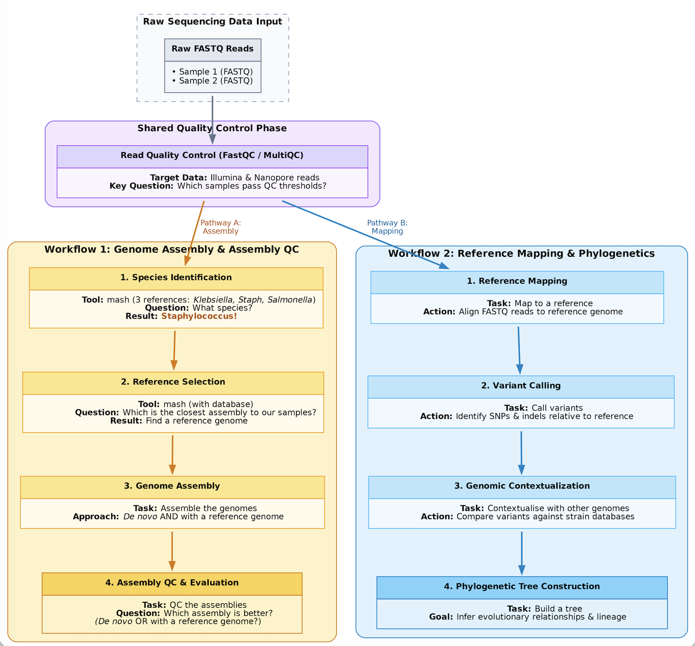

This page is a repository for training resources designed and developed for the short course on Bacterial Genomics Bioinformatics, Babes-Bolyai University, Cluj-Napoca, Romania, October 2026, by Monica Abrudan.

***The materials provided in this repository are FREE to use.*** ***This work is licensed under a Creative Commons Attribution 4.0 International License. Reuse is encouraged with acknowledgement.***

Find out more about the author [here](https://www.linkedin.com/in/monica-abrudan-09bb34a/)

